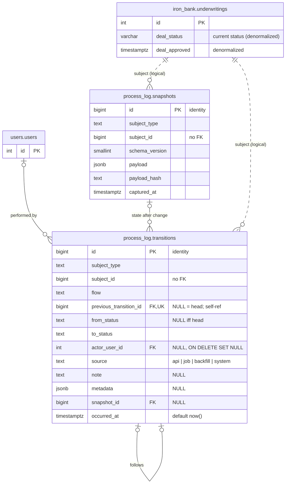

# Process Log: Design (v1)

Status: **Proposed** · Scope: schema + write path only. The analytics that read
it (dashboard metrics 8, 13, 14, 27 in `docs/Analytics_Dashboard_Proposal.md`)
are a follow-up and are only referenced here to justify column choices.

Today `iron_bank.underwritings.deal_status` holds only the current status, so we
cannot tell when a deal changed status, who changed it, or what it was before.
The process log is an append-only, generic history of status changes. Any domain
can log any "flow" (a named status machine) for any subject, without the log
knowing anything about that domain. v1 has exactly one producer:
underwriting `deal_status`.

---

## 1. Decisions

| Topic | Decision |
|---|---|
| Schema | New `process_log` schema with its own Alembic branch (sixth branch). |
| Code location | `app/core/process_log/`, following `app/core/discussions/`. Domains may import it; it never imports a domain. |
| Subject linking | Logical only: `(subject_type, subject_id)`, **no FK**. Rows outlive the subject so history survives a hard delete. |
| Ordering | Linked list via `previous_transition_id` (one successor per row, one head per flow). Chain order is the source of truth; `occurred_at` is informational. |
| Status validation | Stays in the owning domain (`DealStatusService`). The log enforces chain integrity only, not which transitions are legal. |
| Status values | Plain `text` slugs (the `DealStatus` values). No CHECK constraint, so a new flow or status never needs a migration. |
| Snapshots | `process_log.snapshots` ships in v1. The owning domain builds the payload; the log stores it and dedupes by hash. |
| Transactions | Log rows are written in the **same transaction** as the `deal_status` change. `ProcessLogService` never commits; the caller does. |
| Concurrency | Lock the underwriting row (`FOR UPDATE`) before reading the chain tail. `UNIQUE(previous_transition_id)` is the backstop and surfaces as 409. |
| Mutability | Append-only. No update or delete API. Corrections are new rows (`source='system'` with a `note`). |
| Pre-launch history | One backfill row per existing underwriting (`source='backfill'`) seeding its current status. No earlier history is invented. |

### Layering rule

```
iron_bank (domain) ──imports──▶ app/core/process_log ──imports──▶ app/core (database)
   │
   ├── owns the deal_status flow: legal transitions, snapshot payload
   └── calls ProcessLogService only; never queries process_log tables directly
```

- `app/core/process_log` never imports `app.iron_bank` or any other domain.
- v1 has no HTTP routes. Reads for analytics come later, through the service or
  through a read-only analytics repository in `app/analytics/`, following the
  existing cross-domain rule in CLAUDE.md.

---

## 2. Data model



### 2.1 `process_log.transitions`

| Column | Type | Null | Notes |
|---|---|---|---|
| `id` | `bigint` identity (always) | no | PK |
| `subject_type` | `text` | no | `SubjectType` enum value, e.g. `underwriting` |
| `subject_id` | `bigint` | no | No FK (see §1) |
| `flow` | `text` | no | `Flow` enum value, e.g. `deal_status` |
| `previous_transition_id` | `bigint` | yes | NULL means first row of this subject's flow |
| `from_status` | `text` | yes | NULL iff head; equals the previous row's `to_status` |
| `to_status` | `text` | no | |
| `actor_user_id` | `int` | yes | FK `users.users.id` ON DELETE SET NULL. NULL for jobs/backfill |
| `source` | `text` | no | CHECK in (`api`, `job`, `backfill`, `system`) |
| `note` | `text` | yes | Free text, e.g. reason for a correction |
| `metadata` | `jsonb` | yes | Flow-specific extras (e.g. Zillow `home_status` at the time) |
| `snapshot_id` | `bigint` | yes | FK `process_log.snapshots.id` ON DELETE RESTRICT |
| `occurred_at` | `timestamptz` | no | Default `now()`. Backfill rows set it explicitly |

Constraints. The first two are from the original sketch; the rest close holes
the sketch leaves open:

```sql
-- One successor per row: the chain cannot fork.
UNIQUE (previous_transition_id)

-- One head per (subject, flow).
CREATE UNIQUE INDEX uq_transitions_head
  ON process_log.transitions (subject_type, subject_id, flow)
  WHERE previous_transition_id IS NULL;

-- A row may only follow a row of the SAME subject and flow, and its
-- from_status must equal that row's to_status. Composite self-FK onto:
UNIQUE (id, subject_type, subject_id, flow, to_status)   -- uq_transitions_link_target
FOREIGN KEY (previous_transition_id, subject_type, subject_id, flow, from_status)
  REFERENCES process_log.transitions (id, subject_type, subject_id, flow, to_status)
  -- fk_transitions_previous; default NO ACTION, so a row with a successor
  -- can't be deleted alone, but a whole chain can go in one statement

-- Head rows have no from_status; non-head rows must have one.
CHECK ((previous_transition_id IS NULL) = (from_status IS NULL))

-- No no-op transitions.
CHECK (from_status IS DISTINCT FROM to_status)

CHECK (source IN ('api', 'job', 'backfill', 'system'))
```

The composite FK replaces a plain `previous_transition_id → id` FK. With
Postgres's default `MATCH SIMPLE`, a head row (NULL `previous_transition_id` and
NULL `from_status`) is not checked, which is what we want.

Indexes:

| Index | Purpose |
|---|---|
| `uq_transitions_head` (partial, above) | Head lookup and one-head rule |
| `UNIQUE (previous_transition_id)` | Successor lookup and tail detection (anti-join) |
| `(subject_type, subject_id, flow, id)` | Load or walk one subject's chain |
| `(flow, to_status, occurred_at)` | Future analytics: "entered status X in period" |
| `(actor_user_id)` partial `WHERE actor_user_id IS NOT NULL` | FK ON DELETE SET NULL and per-user queries |

### 2.2 `process_log.snapshots`

| Column | Type | Null | Notes |
|---|---|---|---|
| `id` | `bigint` identity | no | PK |
| `subject_type` | `text` | no | |
| `subject_id` | `bigint` | no | No FK |
| `schema_version` | `smallint` | no | Version of the payload shape, owned by the producer |
| `payload` | `jsonb` | no | Built by the owning domain |
| `payload_hash` | `text` | no | SHA-256 of the canonical JSON (sorted keys, no whitespace) |
| `captured_at` | `timestamptz` | no | Default `now()` |

```sql
UNIQUE (subject_type, subject_id, payload_hash)   -- dedupe; reuse the row on conflict
```

Dedupe is per subject, not global. Two underwritings with identical payloads
still get separate rows, so each snapshot belongs to exactly one subject.

**v1 underwriting payload** (`schema_version = 1`), built in iron_bank: the
**full deal**, in the same `GetUnderwritingResult` JSON shape as the n8n
webhook body. That means every `UnderwritingRead` column (financials such as
`total_oop`, `purchase_price`, cash-on-cash, revenue; ids; tag slugs) plus the
child tables `details`, `taxes`, `optimization_list`, `operating_expenses` and
`comp_set`. Two snapshots of one deal can be diffed to see what changed
between status changes.

Fields **resolved from other tables** at send time are left out: `analyst`,
`approver` and `owner` (names and emails; the ids stay), `realtor_details`,
the live-hydrated `zillow_property` for automated deals, every `*_label`
field (the slugs stay), and the read-path-only `simulated`, `discussion` and
`display_id`. This keeps a snapshot changing only when the deal changes (a
renamed realtor must not look like a deal change), avoids extra lookups inside
the locked transaction, and keeps names and emails out of an append-only
table. A stored `zillow_property` on `uw_details` (non-automated deals) is
part of the deal and is included.

`model_dump(mode="json")` renders Decimals as strings, so the hash is stable.
With the full deal in the snapshot, grouped metrics still work for deleted
deals and show values as they were at the time of the change.

### 2.3 Enums (`app/core/process_log/enums.py`)

```python
class SubjectType(StrEnum):
    UNDERWRITING = "underwriting"

class Flow(StrEnum):
    DEAL_STATUS = "deal_status"

class TransitionSource(StrEnum):
    API = "api"
    JOB = "job"
    BACKFILL = "backfill"
    SYSTEM = "system"
```

`SubjectType` and `Flow` are stored as plain text with no CHECK, as in
`discussions.threads.subject_type`. Adding one is a code change only.
`TransitionSource` is a closed set and gets a CHECK.

---

## 3. Module layout

```
app/core/process_log/
  __init__.py
  enums.py         SubjectType, Flow, TransitionSource
  exceptions.py    ConcurrentTransitionError
  models.py        Transition, Snapshot
  schemas.py       RecordTransition (input), TransitionRead
  repository.py    ProcessLogRepository: get_tail, insert_transition, upsert_snapshot
  service.py       ProcessLogService: record_transition, get_history
```

`ProcessLogService` API (never commits; mirrors `DiscussionService`):

```python
async def record_transition(
    self,
    *,
    subject_type: SubjectType,
    subject_id: int,
    flow: Flow,
    expected_from_status: str | None,
    to_status: str,
    source: TransitionSource,
    actor_user_id: int | None = None,
    note: str | None = None,
    metadata: Mapping[str, Any] | None = None,
    snapshot: SnapshotInput | None = None,   # (schema_version, payload)
    occurred_at: datetime | None = None,      # backfill only
) -> int:  # transition id
```

Behaviour:

1. Load the tail for `(subject_type, subject_id, flow)`: the row nothing points to.
2. **Drift repair.** If `tail.to_status` differs from `expected_from_status`,
   the log missed a change (e.g. via the deferred W2 path). Insert a repair row
   first: `tail.to_status → expected_from_status`, `source='system'`,
   `actor_user_id=NULL`, `note='drift repair'`. Then log a warning
   (`process_log.drift_repaired`, with subject and both statuses) and continue.
   The chain stays valid and the real change is still recorded, and the
   warning makes the gap visible. If there is no chain yet and
   `expected_from_status` is not NULL, the repair row becomes the head
   (`NULL → expected_from_status`), which also covers deals the backfill hasn't
   reached. If `expected_from_status` is NULL but a chain exists (status
   cleared outside the log), no repair row is written: a chain can't return to
   NULL, so the real row follows the old tail. If that restores the tail's own
   status, nothing is written and the tail's id is returned.
   A caller passing `expected_from_status == to_status` gets a `ValueError`.
3. Upsert the snapshot if given (`INSERT … ON CONFLICT (subject_type,
   subject_id, payload_hash) DO NOTHING RETURNING id`, falling back to a select).
4. Insert the row with `previous_transition_id = tail.id`,
   `from_status = tail.to_status`, then `flush()`.
5. Map `IntegrityError` on `UNIQUE(previous_transition_id)` or
   `uq_transitions_head` to `ConcurrentTransitionError`.

The caller passes `expected_from_status` from the row it locked. The service
never reads `iron_bank` tables.

`get_history(subject_type, subject_id, flow)` returns the chain in order. It
isn't needed by v1 writers, but it is cheap and useful for tests and a future
"status history" panel.

---

## 4. Write path

### 4.1 Where `deal_status` is written today

| # | Path | File | Sets status to | Log today? |
|---|---|---|---|---|
| W1 | `PATCH /underwritings/{id}/deal-status` | `update_underwriting_service.py:248` `update_deal_status` | validated target | — |
| W2 | Generic `PATCH` update | `update_underwriting_service.py:121`, payload `schemas/update_underwriting.py:21` | anything | **Deferred** (§4.2) |
| W3 | Create (manual, URL, blank, batch jobs) | `save_underwriting_service.py:132` via payload builders' `_DEFAULT_DEAL_STATUS`, or payload | initial | v1 |
| W4 | Duplicate | `duplicate_underwriting_service.py:170` | always `template_generated` | v1 |
| W5 | Legacy sheet import | `scripts/backfill_legacy_underwritings.py:575,1104` | mapped legacy status | **Out of scope**: import is done; existing legacy rows are covered by the §5 backfill |

`update_property_pending` (`:304`) and price reconciliation (`:502`) do not
touch `deal_status` and need no change.

### 4.2 W2 (generic update): deferred

In practice the frontend sends the deal's current `deal_status` unchanged on
the generic PATCH, so it doesn't change status. v1 leaves W2 alone and does not
log from it.

The risk is that if W2 ever *does* change the status, the log falls behind
`underwritings.deal_status`. v1 handles that with **drift repair** in
`record_transition` instead of an error (§3, step 2), so a stale log never
blocks a user's status change. Every repair logs `process_log.drift_repaired`,
which tells us whether W2 needs to be brought into scope.

Later scope: either remove `deal_status`/`deal_approved` from
`UpdateUnderwritingPayload` (a client still sending them gets a 422 from
`extra="forbid"`), or route a changed value through the W1 code path.

> **Note:** `DealStatusService.validate_transition` exists but has **no
> callers**. Today neither W1 nor W2 enforces `DEAL_STATUS_TRANSITIONS` or
> `ROLE_ALLOWED_TARGETS`. Enforcing it is a separate product decision (§9 Q6).
> The log records whatever transition happens; it doesn't need validation to be
> correct.

v1 logs from three places: W1 (transitions), W3 and W4 (creation, head row).

### 4.3 Repository commit control

`UnderwritingRepository.create` and `.update` commit internally
(`underwriting_repository.py:833`). The log row must land in that same
transaction, and on create it needs the new `underwriting.id`, which only
exists after a flush.

Add a keyword-only `commit: bool = True` to both methods. With `commit=False`
they `flush()` instead of `commit()`, then refresh as before. The session uses
`expire_on_commit=False`, so the returned object stays usable after the
caller's commit. The existing `try/except → rollback` stays. Default behaviour
is unchanged for every other caller. The services that log pass
`commit=False`, record the transition, then call `repository.commit()`, which
commits and rolls back on failure.

For the lock, `get_by_id` gains `for_update: bool = False`, following
`DiscussionRepository.get_comment(..., for_update=True)`. It emits
`FOR UPDATE OF underwritings`, so only the underwriting row is locked, not the
tables in the select list's aggregate subqueries. It also sets
`populate_existing` so a copy already in the session is re-read.

The alternative of passing a `before_commit` callback into the repository was
rejected: it hides the transaction boundary inside the repository.

### 4.4 W1: `update_deal_status`

```python
existing = await self.repository.get_by_id(underwriting_id, for_update=True)  # NEW: SELECT … FOR UPDATE
previous_status = existing.deal_status

underwriting_data = {...}                 # unchanged (analyst/approver/deal_approved)
await self._sync_listing_removal(existing, deal_status)
underwriting = await self.repository.update(..., commit=False)

if previous_status != deal_status:        # repeated PATCH: no log row
    await self.process_log.record_transition(
        subject_type=SubjectType.UNDERWRITING,
        subject_id=underwriting.id,
        flow=Flow.DEAL_STATUS,
        expected_from_status=previous_status,
        to_status=deal_status.value,
        source=TransitionSource.API,
        actor_user_id=actor_user_id,
        snapshot=build_underwriting_snapshot(underwriting),
    )
await self.repository.commit()
# webhooks after commit (unchanged)
```

- **Lock.** `FOR UPDATE` serializes two PATCHes on the same deal, so the second
  one reads the first one's status as its `from_status`. Without the lock both
  read the old status, and the second insert would hit
  `UNIQUE(previous_transition_id)`. `ConcurrentTransitionError` (409) then only
  fires if something writes without the lock.
- **Same status.** A repeated PATCH (double-click, client retry) is a no-op for
  the log: the `previous_status != deal_status` guard skips it, and the CHECK
  backs that up. This matches the existing webhook guard.
- **NULL current status** (the 7 blank deals): `previous_status = None`. If the
  deal has no chain, the first status set writes the head row.
- **Errors.** `ConcurrentTransitionError` maps to 409. A log mismatch is
  repaired, not raised (§3 step 2).

### 4.5 W3 and W4: creation writes the head row

After `repository.create(..., commit=False)`, if `underwriting.deal_status` is
not NULL:

```python
await self.process_log.record_transition(
    ..., expected_from_status=None, to_status=underwriting.deal_status,
    source=TransitionSource.JOB if is_batch else TransitionSource.API,
    actor_user_id=current_user_id_or_none,
    snapshot=build_underwriting_snapshot(underwriting),
)
```

`source` is `job` when the create comes from a workflow job (batch
prepare-and-save) and `api` otherwise.

**W4 (duplicate).** A copy always starts at `template_generated`
(`duplicate_underwriting_service.py:170`). `deal_status` is in
`_UNDERWRITING_NON_COPYABLE`, because copying a terminal status would freeze
the copy. So the copy gets a fresh chain whose head is
`NULL → template_generated`, with `actor_user_id = current_user_id` and
`metadata = {"copied_from_id": source_id}`. The source's history is not copied:
history is per underwriting row, matching how discussions treats versions.

Placement matters. `duplicate()` retries `repository.create` on a
series/version conflict, and `create` rolls the session back on that failure.
Call `create(..., commit=False)` inside the retry loop as today, and record the
head row and commit only **after** the loop exits with a created row. A conflict
detected at flush still raises inside `create`, so the retry logic is unchanged.
`DuplicateUnderwritingService.__init__` gains a `process_log` argument.

### 4.6 Snapshot builder

`app/iron_bank/services/deal_status_history.py` (new):

- `underwriting_document(u)`: the parent row and child tables in
  `GetUnderwritingResult` shape. **Shared with the n8n webhook**:
  `_trigger_n8n_webhook` starts from it and adds the resolved parts, so the
  snapshot and the webhook body can't drift apart.
- `build_underwriting_snapshot(u) -> SnapshotInput`: the payload in §2.2,
  `schema_version=1`.
- `record_created(...)`: writes the head row for a new underwriting (W3, W4).
  It loads the children first with `repository.load_children()`
  (`refresh(attribute_names=[…])`), because `create` adds them as separate
  rows and lazy loading isn't possible under asyncio. W1 needs no extra load:
  `get_by_id` eager-loads the children and `refresh` reloads them.
- Constant `UNDERWRITING_SNAPSHOT_VERSION = 1`.

It lives in iron_bank because only iron_bank knows the underwriting's shape.
Changing the payload shape means bumping the version. Old rows are never
rewritten.

### 4.7 Wiring

`process_log` is an **optional** constructor argument on
`SaveUnderwritingService` (inherited by `UpdateUnderwritingService`) and
`DuplicateUnderwritingService`, following the existing optional collaborators
(`reference_data_service`, the webhook services). Without it nothing is logged,
which keeps the ~70 existing unit-test constructions unchanged.
`SaveUnderwritingService` also takes `log_source` (default `api`).

Every production construction passes it, with the **same `db` session** as
`UnderwritingRepository(db)`:

- `router.py`, through `_process_log_service(db)`: save, create-from-URL,
  create-blank, update and duplicate factories.
- `PrepareAndSaveUnderwritingJob.from_session`, with `log_source=job`.

`tests/iron_bank/test_deal_status_logging.py` asserts this wiring, including
that the log and the repository share one session, so a new factory that
forgets it fails a test. `ReconcileUnderwritingPriceJob` builds an
`UpdateUnderwritingService` without it on purpose: it never changes status.

Creates have no actor yet (`actor_user_id=NULL`): `save()` isn't passed the
current user. Duplicates record the user who duplicated.

---

## 5. Backfill of existing underwritings

One-off script `scripts/backfill_deal_status_history.py`, idempotent, run once
per environment after the migration and **after** the write path is deployed.
Rows created between deploy and backfill already have heads and are skipped.

For each underwriting with `deal_status IS NOT NULL` and no head row:

| Field | Value |
|---|---|
| `from_status` / `previous_transition_id` | NULL (head) |
| `to_status` | current `deal_status` |
| `source` | `backfill` |
| `actor_user_id` | `approver_id` if status is `present_to_clients` / `client_under_contract`, else NULL |
| `occurred_at` | `deal_approved` for those two statuses when set; else `updated_at`; else `created_at` |
| `note` | `"seeded from current status"` |
| `snapshot` | built from the current row |

It runs in batches of 1,000 with `INSERT … SELECT … WHERE NOT EXISTS` against
the head index, so a rerun is a no-op. It has a `--dry-run` flag that prints
counts per status.

These rows say "was in status X as of T". They do not mean "entered X at T".
Analytics must treat `source='backfill'` heads as a coverage boundary (see the
analytics follow-up).

---

## 6. Migration

New branch `process_log`, matching the discussions pattern:

1. `init_process_log`: `branch_labels=("process_log",)`, `CREATE SCHEMA IF NOT
   EXISTS process_log`; downgrade drops the schema without CASCADE.
2. `create_process_log_tables`: `down_revision` = (1),
   `depends_on=("b7e9a21cb997",)` (users table, for the actor FK). Creates
   `snapshots` first, then `transitions` with the constraints and indexes in §2.
   The composite self-FK is added with `op.create_foreign_key` after the table
   and its `uq_transitions_link_target` exist.

`migrations/env.py`: add `import app.core.process_log.models` and
`"process_log"` to `TARGET_SCHEMAS`. Autogenerate does not reliably emit the
partial unique index or the composite self-FK, so review the generated
migration by hand.

CLAUDE.md: add `process_log` to managed schemas, branch count five → six, and a
line under **Shared**.

---

## 7. Testing

Unit and DB tests in `tests/core/process_log/`:

- Head insert; second head for same subject/flow → `IntegrityError`.
- Append to tail; forking (two rows with the same `previous_transition_id`) → rejected.
- Composite FK: linking to another subject's row, or `from_status` ≠ previous `to_status` → rejected.
- CHECKs: head with `from_status`, non-head without it, X→X, bad `source`.
- Drift repair: `expected_from_status` ≠ tail → a `system` repair row then the real row, chain valid, warning logged. No chain + non-NULL expected → repair row is the head.
- Snapshot dedupe: same payload twice → one snapshot row, both transitions point to it.
- Service never commits (rollback after `record_transition` leaves no rows).

iron_bank tests:

- `update_deal_status` writes exactly one row with correct `from`/`to`/actor/snapshot, in the same transaction (forced failure after record → no status change, no log row).
- Webhooks still fire only after commit.
- Two concurrent `update_deal_status` calls on one deal: one succeeds, the other is validated against the new status (lock), and the chain has no fork.
- Create and batch-job create write a head row with the right `source`.
- Duplicate writes a `NULL → template_generated` head with `copied_from_id` in `metadata`. A forced version conflict on the first attempt still ends with exactly one underwriting and one head row.
- W2 changing `deal_status` (simulated), followed by a W1 change → repair row + real row, no error.

Drift check (test and a SQL query for ops): for every underwriting, the
chain's tail `to_status` equals `deal_status`. Run it after the backfill and
periodically. It should return zero rows.

```sql
SELECT u.id, u.deal_status, t.to_status
FROM iron_bank.underwritings u
LEFT JOIN process_log.transitions t
  ON t.subject_type = 'underwriting' AND t.subject_id = u.id AND t.flow = 'deal_status'
 AND NOT EXISTS (SELECT 1 FROM process_log.transitions n WHERE n.previous_transition_id = t.id)
WHERE u.deal_status IS DISTINCT FROM t.to_status;
```

---

## 8. Rollout

1. Migration + `app/core/process_log/` module + tests. No behaviour change.
2. Repository `commit=` flag, `commit()`, and `get_by_id(..., for_update=True)`.
3. Wire W1, W3, W4. Deploy to dev and run the drift check on new deals.
4. Run the backfill on dev, then the drift check (expect zero), then prod.
5. Update CLAUDE.md.
6. Watch `process_log.drift_repaired`. Non-zero means W2 changes status in practice and should be brought into scope.

Steps 1–3 should ship as early as possible: history only accumulates from the
day the write path is live.

---

## 9. Open questions

1. **W2 (generic update), later scope.** Remove `deal_status` from the payload, or route changes through W1. Drift-repair warnings will tell us how urgent this is.
2. **Should `deal_approved` stay denormalized** on `underwritings`? It can be derived from the log, but existing filters (`min_deal_approved`) use it, so v1 keeps writing both.
3. **Zillow listing status as a second flow** (`subject_type='listing'`, `flow='zillow_status'`, written by the listings refresh job). The schema supports it unchanged; it would make "went off the market after we presented it" measurable. Out of scope for v1, but worth scheduling soon for the same reason: no history until it ships.
4. **Analyst assignment** isn't a status, so it isn't in this log. v1 captures `analyst_id` in each snapshot. If assignment history matters later, a separate `assignment` flow can be added without a schema change.
5. **Retention.** None planned; volume is roughly one row per status change (low thousands per month).
6. **Enforce `validate_transition` on W1?** It is defined but never called, so any status can currently move to any other. Independent of the log, but once history exists, illegal moves become visible, and that may prompt the decision.
